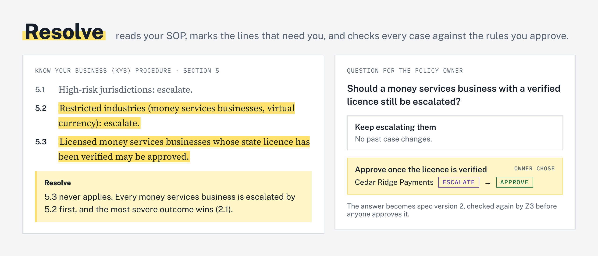

# Resolve

<picture>
  <source media="(prefers-color-scheme: dark)" srcset="docs/images/resolve-hero-dark.png">
  
</picture>

Resolve turns an operations team's standard operating procedure (SOP), the written steps people follow, into rules a solver can check. An agent gathers the facts for each case, the approved rules decide, and Resolve names any fact still missing so the agent goes back for it.

Before any case runs, Z3 checks the SOP itself: rules that can never apply, unknowns hidden behind an escalation, and what changes between versions. The policy owner answers each finding, and the answers become the next version. The rules are applied by an evaluator with Dafny proofs that it never approves on an unknown and that filling in an unknown never undoes an answer.

The demo is Know Your Business (KYB): the checks a bank runs to confirm who owns and controls a company before opening its account. A second, small SOP for employee expense claims runs on the same core.

## Try it

- **In the browser:** [resolve-process-factory.pages.dev](https://resolve-process-factory.pages.dev). [Try it](https://resolve-process-factory.pages.dev/try/) runs the real evaluator and Z3 on the six example cases as you change their facts. [The tour](https://resolve-process-factory.pages.dev/tour/) replays one recorded run of the whole loop. [The system map](https://resolve-process-factory.pages.dev/map/) shows each part and how it took shape.
- **In Claude Code:** the Resolve pane is a Claude Code mod, and this repo is its marketplace.
  ```
  /plugin install resolve --marketplace jinalex/resolve-process-factory
  ```
  Then `/resolve` opens the pane. It shows sample data until `pnpm resolve` has run in the project. See [mod/resolve/README.md](mod/resolve/README.md).
- **From a checkout:** Node 22.23.4 or later and pnpm.
  ```
  pnpm install
  pnpm test        # outcomes, Z3's checks, and Z3 agreeing with the evaluator, on both SOPs
  pnpm resolve     # Resolve's checks on the KYB SOP and example cases, written into .resolve/ for the pane
  ```
  Commands that call Claude need `RESOLVE_ANTHROPIC_API_KEY`. Every command is listed under [Running it](#running-it).

## What it found

60 synthetic KYB cases, each run three times end to end, with the same agent, tools and mocked evidence in both arms. "Alone" means the model reads the SOP and decides. "With Resolve" means the model gathers facts and the rules decide. The answer key is the approved spec, so "agrees" means agrees with the policy owner's reading.

| Setup | Agrees with the approved spec | Dangerous approvals | Cost per case |
| --- | --- | --- | --- |
| Haiku 5.5 alone | 143/180 (79%) | 6 | $0.0010 |
| Opus 5.5 alone | 153/180 (85%) | 3 | $0.0296 |
| Haiku 5.5 with Resolve | 180/180 (100%) | 0 | $0.0011 |

A dangerous approval approves a case the spec would escalate, decline or send back for documents. With Resolve, the cheapest model made no wrong decisions, for less than a twentieth of what Opus alone cost. Full table and method: [bench/results/ladder.md](bench/results/ladder.md).

## What's real and what's mocked

| Part | Status |
| --- | --- |
| Deciding a case from the rules | Real. The Dafny evaluator, with proofs that it never approves on an unknown and that filling in an unknown never undoes an answer. |
| Checking the SOP | Real. Z3 on the spec. |
| What each of the owner's answers would change | Real. Worked out by Z3 and the evaluator before the owner answers. |
| Turning the SOP into rules, writing the owner's questions | Claude, live from a checkout or in the mod. The draft only proposes: it is checked against the SOP and by Z3, and a person approves each version. The hosted site shows a recorded run. |
| The cases and their evidence | Mocked. Finding and reading evidence is a separate system. The example cases, documents and case files are made up, and the bank in the SOP is fictional. |

The KYB SOP, the cases and the answer key were written for this prototype by the team building it.

Every model output passes through a verified check or a person. What each check covers, and what it doesn't, is in [docs/WHAT-IS-VERIFIED.md](docs/WHAT-IS-VERIFIED.md).

## Status

Built: the spec checker, the 60-case world, the case runner, the verifier, the improve loop and the Dafny proofs of the evaluator. Still planned: two more Dafny proofs, that the ownership check is sound for any number of owners at any depth, and that the outcome doesn't depend on rule order.

## Where to look next

- [docs/DECISIONS.md](docs/DECISIONS.md): what was decided and why. [docs/PRINCIPLES.md](docs/PRINCIPLES.md): the rules those decisions follow.
- [docs/NOT-BUILT.md](docs/NOT-BUILT.md): alternatives tried or considered and set aside.
- [sop/kyb_sop.md](sop/kyb_sop.md) and [spec/kyb-v1.json](spec/kyb-v1.json): the SOP and the same SOP as rules. Each rule keeps the sentence it came from.
- [docs/experiments/formal-compare/](docs/experiments/formal-compare/): the same SOP in Z3, Dafny and Lean, the evidence for choosing Z3 for each SOP and Dafny once for the engine.

## Layout

Resolve is a general core plus one pack per domain. The core knows nothing about KYB: a spec names its own outcomes and their order, its facts, the lists of items a case has (KYB: people; expenses: lines), and the facts the pack computes. A pack turns its raw case into that shape and adds any checks of its own.

- `core/`: the general core.
  - `spec.ts`: the rule format. Rules are data: a condition on named facts and the outcome it leads to.
  - `dafny/evaluate.dfy`: the evaluator, with its proofs. It is compiled to the committed `evaluate.cjs`, so running Resolve needs no Dafny. `evaluate.ts` is the adapter to it.
  - `z3.ts`, `sop-checks.ts`: Z3's checks on the SOP (rules that never apply, unknowns handled differently from the unknowns rule, facts that never change an outcome, what changes between versions). `show-z3.ts` prints each rule's formula next to its SOP sentence.
  - `spec-edit.ts`, `impact.ts`, `answers.ts`, `next-spec.ts`: the owner's answers become the next, unapproved spec version, with what each option would change worked out first.
  - `evidence.ts`: the evidence checks that hold in any domain (every fact has a source, every quote is in the cited page, the outcome follows from the facts).
  - `pane.ts`, `rule-formulas.ts`: write everything above in the shape the pane reads.
- `drafting/`, `prompts/`: Claude drafts a spec from an SOP, and every draft is checked against the SOP, by Z3 and against the approved spec. Saved calls are in `runs/`.
- `packs/kyb/`: KYB beneficial ownership: ownership across chains of companies with exact fractions, the case file's facts, KYB's own case-file checks, and the mocked evidence.
- `packs/expenses/`: employee expense claims, a second small SOP on the same core.
- `sop/`, `spec/`: the SOPs as written, and each as rules. Each rule keeps a stable ID, its SOP section and the sentence it came from.
- `packs/kyb/cases/examples/`: the six KYB example cases with their documents. With the hand-made case files, they stand in for the evidence system.
- `replay/`: the tour's source, one recorded run of the whole loop ([hosted](https://resolve-process-factory.pages.dev/tour/)). It shows the files Resolve wrote at each step and calls no model or solver.
- `runner/`: the case runner agent. `bench/`: agentic review compared with Resolve (below).
- `mod/resolve/`: the Resolve pane, a Claude Code mod. `docs/INTERFACE.md`: the files the core writes into `.resolve/` and the pane reads.
- `docs/`: decisions, principles, what is verified, what wasn't built, the system map's source (`architecture/index.html`) and the brand kit (`brand/`).
- `docs/experiments/formal-compare/`: the same SOP in Z3, Dafny and Lean.

## Agentic review vs Resolve

How cases are processed today without Resolve: an agent reads the SOP and decides each case itself. That is **agentic review**, and `bench/` compares it with Resolve. Both arms are the same case runner agent (`runner/`), with the same tools, model and mocked evidence (`packs/kyb/evidence-mock.ts`); the only difference is where the decision is made. With Resolve, the approved rules decide from what the agent gathered and name the facts still missing, and the agent goes back for them.

- `bench/cases.ts`: 60 synthetic KYB cases from a seeded generator, weighted toward the edges the SOP changes and planted problems touch.
- `bench/changes.ts`: three SOP changes, each written once as SOP words (what agentic review reads) and once as spec (what Resolve reads).
- `bench/run.ts`: runs agentic review on every case, three times under the SOP as written and once under each changed SOP, plus both arms end to end; every run is recorded under `bench/runs/`.
- `bench/compare.ts`: the tables in `bench/results/`: agreement with the approved spec, the same case getting different outcomes, whether reasons cite the deciding section, which past cases each change flips and how long finding out takes, and time and cost per case.
- `bench/ladder.ts`: the model ladder in `bench/results/ladder.md`: each model end to end on all 60 cases, three times, alone and with Resolve, with correct outcomes, dangerous approvals and cost per case. It asks whether a cheap model is safe once Resolve decides. Its runs are kept packed, one `.jsonl.gz` a model under `bench/runs/ladder/`.

The result is under [What it found](#what-it-found). The answer key is the approved spec, so "agrees" means agrees with the policy owner's reading. See "Agentic review as the baseline" in `docs/DECISIONS.md`.

## Running it

Node 22.23.4 or later (the 21 October 2026 security release) runs the TypeScript directly.

```
pnpm install
pnpm test                             # both packs: outcomes, Z3's checks, Z3 agreeing with the evaluator, the case file checks
pnpm examples                         # prints each KYB example's outcome and why
pnpm check-cases                      # Resolve's checks on the six KYB example case files
pnpm resolve                          # the same checks, written into .resolve/ for the Resolve pane (docs/INTERFACE.md)
pnpm check-sop                        # Z3's findings on the KYB SOP (add --json for the pane's format)
pnpm show-z3                          # each rule's Z3 formula next to its SOP sentence (add --raw for Z3's own numbers)
pnpm check-sop spec/expenses-v1.json  # the same checks on the expenses SOP
pnpm propose-spec                     # Claude drafts the KYB spec from the SOP, and every check runs on it (needs RESOLVE_ANTHROPIC_API_KEY)
pnpm propose-spec spec/expenses-v1.json
pnpm replay <run id>                  # checks a saved draft again, offline (add --live to ask Claude again with the same prompt)
pnpm write-options                    # Claude writes each open finding's question, options and the spec edit each option means (needs RESOLVE_ANTHROPIC_API_KEY); pnpm resolve then works out what each option would change
pnpm next-spec                        # the owner's sent answers in .resolve/answers.jsonl become the next spec version, unapproved, with what it changes
pnpm run-case --arm agentic --level e2e --case EX-1   # the case runner on an example (needs RESOLVE_ANTHROPIC_API_KEY)
pnpm bench                            # agentic review vs Resolve on 60 synthetic cases (about 400 model runs)
pnpm compare                          # the comparison tables from the recorded runs; no model calls
pnpm build-replay                     # builds replay/index.html from the recorded run in replay/recording/ (add --check to compare)
pnpm bench --only e2e --e2e 60 --e2e-reps 3 --model claude-haiku-5-5 --effort low --out bench/runs/ladder/haiku-5-5-low   # one rung of the ladder
pnpm ladder --pack                    # the ladder table from bench/runs/ladder/, packing each model's runs into one file; no model calls
pnpm improve                          # score each version of the review notes (bench/notes/) and write .resolve/rounds.json; no model calls
pnpm build-dafny                      # verifies the Dafny proofs and recompiles the evaluator (needs Dafny 4.11; add --check to compare with the committed file)
```
